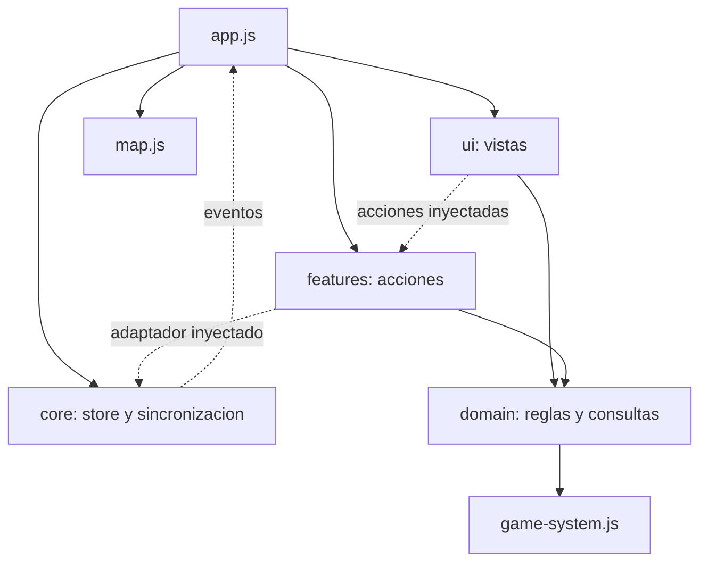

# Arquitectura modular de Mesa Arcana

La refactorizacion conserva las reglas, el HTML de las fichas, los datos del sistema y el formato de Firebase. `app.js` construye las dependencias, inicializa las vistas y coordina los eventos. No contiene formulas de personaje ni operaciones de combate.

## Arbol definitivo

```text
Mesa Arcana/
  index.html
  app.js
  game-system.js
  firebase-config.js
  map.js
  map.test.js
  v3-ui.js
  styles.css
  v3-ui.css
  manifest.webmanifest
  package.json
  README.md
  .gitignore
  core/
    state.js
    firebase.js
    storage.js
    utils.js
  domain/
    character-rules.js
    entities.js
  features/
    rooms.js
    characters.js
    combat.js
    dice.js
    scenes.js
    entities.js
    library.js
    map-sync.js
  ui/
    dom.js
    components.js
    navigation.js
    home.js
    player.js
    dm.js
    board.js
    rolls.js
  styles/
    theme/
      base.css
      elegant.css
    shared/
      shell.css
      cards.css
      controls.css
      workspace.css
      session.css
      feedback.css
      navigation.css
      panels.css
      elegant.css
      workspace-elegant.css
      panels-elegant.css
      feedback-elegant.css
    roles/
      home-base.css
      lobby-base.css
      home-elegant.css
      player-base.css
      player-layout.css
      dm-layout.css
      dm-dashboard.css
      board-base.css
      board-layout.css
      board-elegant.css
    responsive/
      base.css
      workspace.css
      elegant.css
    modules/
      map.css
  tests/
    rules.test.js
    actions.test.js
    architecture.test.js
    browser.html
    browser-suite.js
    role.html
    role-client.js
    helpers/
      fake-firebase.js
  tools/
    prepare-browser-tests.mjs
    verify-rule-parity.mjs
    verify-css-parity.mjs
  docs/
    MODULOS.md
```

Los logs del servidor son archivos locales ignorados por Git. No hay dependencias npm de produccion, compilacion ni bundler.

## Responsabilidades y direccion de dependencias

| Modulo | Responsabilidad |
| --- | --- |
| `app.js` | Construye el store, el adaptador, las acciones y las vistas; conecta sus eventos e inicia la aplicacion. |
| `game-system.js` | Exporta `system`: atributos, habilidades, linajes, clases, trasfondos, rasgos, limites y biblioteca originales. |
| `firebase-config.js` | Exporta `firebaseConfig` y `ROOT_PATH`; mantiene proyecto y ruta actuales. |
| `core/state.js` | Estado compartido por instancia, preferencias de navegacion y eventos. |
| `core/firebase.js` | Unico propietario de referencias del SDK, listener de sala y escrituras; incluye la ejecucion local sin SDK. |
| `core/storage.js` | Persistencia de la sesion en localStorage, sustituible por almacenamiento en memoria. |
| `core/utils.js` | Codigos de sala, valores aleatorios, iniciales, formato de bonos y sala local inicial. |
| `domain/character-rules.js` | Funciones puras de atributos, habilidades, puntos, rasgos y estadisticas derivadas; no lee formularios. |
| `domain/entities.js` | Consultas de nombres y correspondencia entre tipos y colecciones. |
| `features/rooms.js` | Crear, entrar, restaurar y borrar salas; validacion del codigo de borrado. |
| `features/characters.js` | Cambiar la configuracion local, guardar borradores y finalizar la ficha. |
| `features/combat.js` | Iniciativa manual, siguiente turno y seleccion manual de actor. |
| `features/dice.js` | Tiradas libres y consultas de atributos con desglose; persistencia de tiradas. |
| `features/scenes.js` | Construccion y guardado de la escena publica. |
| `features/entities.js` | Vida, mana, objetos, condiciones, notas, turnos y retirada manual. |
| `features/library.js` | Convertir una tarjeta de biblioteca a la entidad persistida original. |
| `features/map-sync.js` | Enviar parches del mapa por el adaptador, sin modificar su esquema. |
| `ui/player.js` | Formularios, previsualizacion, ficha final, dados y resumen de partida del jugador. |
| `ui/dm.js` | Presentacion de la mesa, actores, turnos, filtros y biblioteca; traduce controles a acciones. |
| `ui/board.js` | Escena, fichas, mapa publico, tiradas y vista limpia. |
| `ui/navigation.js` | Mostrar roles y paginas; navegacion En vivo/Preparacion y visibilidad de paneles. |
| `ui/home.js` | Formularios de entrada, lista de salas, copiar codigo y abrir tablero. |
| `ui/components.js` | Iconos actuales, paneles plegables, estado de conexion y avisos. |
| `ui/rolls.js` | Presentacion compartida del historial de tiradas en DM y tablero. |
| `ui/dom.js` | Busqueda de elementos del documento. |
| `v3-ui.js` | Abrir/cerrar el detalle de un actor con clic, Enter, Espacio y Escape. |
| `map.js` | Canvas, imagen, cuadricula, posiciones, vision, niebla, zoom, alineacion y exportacion; no importa Firebase. |



No hay imports circulares. Las vistas reciben acciones; las acciones reciben el store y el adaptador. El adaptador avisa a la aplicacion cuando recibe una sala. Las vistas no importan las implementaciones de las acciones.

## Contratos compartidos

`State` contiene `roomCode`, `role`, `participantId`, `participantName`, `room`, `connected`, `hasShownRole`, `activeLibrary`, `activeFocusFilter`, `localBonus` y `skillTraining`. `room` sigue siendo la estructura original de Firebase. No se agregan referencias del SDK al estado. El objeto `state` mantiene su identidad incluso despues de `reset()`.

`store.ui` contiene `playerPage`, `dmMode` y `dmPage`. Son preferencias locales y no se guardan en Firebase. Las acciones actualizan los datos del juego; las vistas pueden actualizar estas preferencias y cargar en el estado local el borrador recibido.

`Build` contiene `lineage`, `classKey`, `background`, `localBonus` y `skillTraining`. Los mapas de bonos/entrenamiento se obtienen con `emptyAttributeMap()` y `emptySkillMap()`. Para guardar, `CharacterInput` agrega `name`, `hpCurrent`, `manaCurrent`, `inventory` y `notes`. Las claves corresponden al catalogo `system`.

`SceneInput` contiene `title`, `description` y `mode`. `EntityType` es `character`, `enemy`, `npc` u `object`. `MapPatch` es un objeto con claves relativas al mapa, incluidas claves como `positions/characters_ID` o `explored/c_X_Y`.

Las acciones de escritura devuelven `Promise<void>` cuando escriben; pueden devolver `undefined` cuando la operacion no corresponde o una validacion impide ejecutarla. Las promesas siguen el comportamiento del SDK: los avisos no convierten una escritura rechazada en una escritura exitosa. La actualizacion de pantalla ocurre al recibir el evento de la sala, no al esperar un resultado narrativo.

### Estado y eventos

`createStore() -> {state, ui, on, emit, reset}` crea una instancia independiente.

| Funcion | Argumentos | Retorno |
| --- | --- | --- |
| `on(event, listener)` | Nombre de evento y callback `(payload) => void` | Funcion para desuscribirse. |
| `emit(event, payload?)` | Nombre y datos del evento | `undefined`; callbacks sincronicos. |
| `reset()` | Ninguno | `undefined`; restaura estado inicial, conservando identidad y preferencias UI. |

| Evento | Payload | Emisor / consumidor |
| --- | --- | --- |
| `room:changed` | `{room, connected}` | Adaptador -> coordinador de renderizado. |
| `build:changed` | Sin payload | Personajes -> previsualizacion del jugador. |
| `notice` | Texto | Acciones/adaptador -> aviso visual. |
| `rooms:changed` | Sin payload | Borrado de sala -> lista de salas. |
| `session:cleared` | Sin payload | Borrado de sala actual -> pantalla de inicio. |

Los eventos son locales. No son nuevos campos de Firebase. La confirmacion de una escritura remota llega por el listener original `value`.

### Sincronizacion y almacenamiento

`createFirebaseSync({store, storage, sdk?, config?, rootPath?})` devuelve el siguiente adaptador. En produccion usa el SDK compat ya cargado por `index.html`. `sdk: null` activa el modo local. Los valores por defecto siguen apuntando al Firebase actual.

| Metodo | Argumentos | Retorno / efecto |
| --- | --- | --- |
| `connectToRoom(code, role, name, participantId, initialRoom = null)` | Identidad de sesion y, opcionalmente, una sala nueva | `Promise<void>`; guarda sesion, cambia listener y emite la sala. |
| `listRooms()` | Ninguno | `Promise<Record<code, room>>`; consulta la raiz original. |
| `removeRoom(code)` | Codigo de sala | `Promise<void>`; borra esa sala. La validacion del codigo de borrado pertenece a `features/rooms.js`. |
| `set(path, value)` | Ruta relativa y valor JSON; `null` elimina | `Promise<void>`; conserva el esquema del valor. |
| `update(path, patch)` | Ruta relativa y parche; admite rutas internas con `/` | `Promise<void>`. |
| `remove(path)` | Ruta relativa | `Promise<void>`; elimina ese nodo. |
| `disconnect()` | Ninguno | `undefined`; retira el listener y la referencia de sala. |
| `isRemote()` | Ninguno | Booleano: existe una referencia remota activa. El estado de lectura se consulta en `state.connected`. |

El modo local aplica las mismas rutas a `state.room` y emite `room:changed`. Un reemplazo del adaptador debe mantener esta semantica, las promesas y la retirada del listener al cambiar de sala. La promesa de `connectToRoom` termina al registrar la suscripcion; para saber que la sala ya se recibio, escuchar `room:changed`.

`createStorage(storage = localStorage)` devuelve `readLocal(key) -> JSON|null`, `writeLocal(key, value) -> void` y `removeLocal(key) -> void`. El almacenamiento inyectado implementa `getItem`, `setItem` y `removeItem`. Se conserva la clave `mesaArcanaSession` y sus campos.

### Reglas puras

Todas las siguientes funciones son exports de `domain/character-rules.js` y no producen eventos ni escriben datos:

| Export | Argumentos | Retorno |
| --- | --- | --- |
| `getAttributeTotals` | `Build` | Mapa de atributo -> valor total. |
| `getSkillBonuses` | `Build` | Mapa de habilidad -> bono; conserva el maximo entre inicial y entrenado. |
| `getGrantedSkills` | `Build` | `Set<string>` de habilidades iniciales. |
| `getTraitKeys` | `lineageKey, classKey, backgroundKey` | Array de claves de rasgo sin duplicados. |
| `getFreePoints` | `Build` | Puntos de atributo restantes. |
| `getFreeSkillPoints` | `Build` | Puntos de habilidad restantes, incluido el extra humano. |
| `getActiveSkillCount` | `Build` | Cantidad total de habilidades activas sin duplicados. |
| `calculateDerivedStats` | `Build` | `{hpMax, manaMax, defense, initiative}`. |
| `getAttributeModifier` | Valor numerico | Modificador original: `floor(valor / 2)`. |
| `emptyAttributeMap`, `emptySkillMap` | Ninguno | Nuevo mapa con todas las claves en cero. |
| `getAttributeName`, `getSkillName` | Clave | Nombre del catalogo o la propia clave. |
| `getFocusFilter` | Clave del filtro DM | `{name, attributes, skills}`, con Social como fallback. |

`domain/entities.js` exporta `getCollectionForType(type) -> string`, `getEntityName(room, id) -> string` y `getCurrentActorName(state) -> string`. Se mantienen los fallbacks originales de nombres.

`core/utils.js` exporta `initials(value) -> string`, `formatBonus(value) -> string`, `normalizeRoomCode(value) -> string`, `randomInt(min, max) -> integer`, `generateRoomCode() -> string` y `buildOfflineRoom() -> room`.

### Acciones de cada modulo

Las factorias se invocan una vez por aplicacion. Los argumentos de una accion son datos, no eventos de DOM.

| Factoria / dependencias | Metodos publicos |
| --- | --- |
| `createRoomActions({store,sync,storage,dialogs})` | `createRoom({campaignName,hostName})`, `joinRoom({roomCode,name,role})`, `restoreSession()`, `deleteRoom(roomCode)`. Conectan/restauran/borran; retornan promesa o `undefined`. |
| `createCharacterActions({store,sync})` | `saveCharacter(CharacterInput)`, `finalizeCharacter(CharacterInput)` escriben la ficha; `isCharacterFinalized() -> boolean`; `changeLocalBonus(key,delta,Build)`, `toggleSkillTraining(key,Build)`, `resetCharacterBuild()` cambian configuracion local y emiten `build:changed`. |
| `createCombatActions({store,sync})` | `startCombat()`, `nextTurn()`, `markTurn(id)`: promesa o `undefined`, segun exista orden/participantes. |
| `createDiceActions({store,sync,random?})` | `rollFreeDie(dieSize)`, `rollAttributeCheck(attributeKey)`, `writeRoll(roll)`: promesa o `undefined`. `random(min,max)` permite dados deterministas en pruebas. |
| `createSceneActions({store,sync})` | `saveScene(SceneInput)`: promesa, agrega `updatedAt` y emite aviso. |
| `createEntityActions({store,sync,combat,dialogs})` | `updateEntity(type,id,action)`: promesa o `undefined`. Acciones: `remove`, `turn`, `inventory`, `condition`, `note`, `manaDown`, `manaUp`, `damage`, `heal`. |
| `createLibraryActions({sync})` | `showLibraryCard(kind,index)`: promesa o `undefined`; `kind` es `enemies`, `npcs` u `objects`. |
| `createMapActions({store,sync})` | `writeMap(MapPatch)`: promesa o `undefined`; comunica fallos mediante `notice`. |

`dialogs.prompt(message) -> string|null` es una dependencia inyectable para solicitudes manuales de notas, objetos y borrado. En produccion usa el dialogo actual del navegador.

`features/library.js` tambien exporta `normalizeLibraryEntity(card,type,id) -> entity`. Conserva los campos `id`, `visible`, `cardType`, `name`, `kind`, `threat`, `role`, `attitude`, `description`, `notes`, `stats`, `hp`, `hpCurrent`, `hpMax` y `createdAt`.

### Vistas, navegacion y mapa

| Export | Dependencias y contrato |
| --- | --- |
| `createPlayerView({store,actions})` | Devuelve `bind()`, `render()`, `refreshCharacterPreview()` y `readBuild() -> CharacterInput`. |
| `createDmView({store,actions})` | Devuelve `bind()` y `render()`. |
| `createBoardView({store,actions,map})` | Devuelve `bind()` y `render()`. Sincroniza el canvas con la sala y conecta el callback de escritura. |
| `createHomeView({store,sync,actions,navigation})` | Devuelve `bind()` y `loadActiveRooms() -> Promise<void>`. |
| `createNavigation({store})` | Devuelve `bind()`, `render()`, `showView(name)`, `showRoleView()`. Los nombres de vista son `home`, `player`, `dm`, `board`. |
| `renderRolls(feed,room)` | Escribe el historial en un elemento DOM; retorna `undefined`. |
| `hydrateIcons()`, `setupCollapsiblePanels()`, `renderStatus(state)`, `toast(message)` | Componentes DOM compartidos; retornan `undefined`. |
| `byId(id)`, `$(selector)` | Retornan el elemento DOM o `null`. |
| `bindEntityInspection()` | Registra los controles del detalle de actores; retorna `undefined`. |
| `createMap({document?,window?,ResizeObserver?,Image?})` | Devuelve `init()`, `sync(room,writer)`, `reveal()` y `fit(role)`. `writer(MapPatch)` conecta el mapa al resto; `role` es `dm` o `public`. |

`bind()` e `init()` se ejecutan una sola vez sobre el documento actual. `render()` y `sync()` pueden repetirse al recibir datos. Las vistas conservan los IDs y `data-*` originales de `index.html`. Para cambiar una vista con otra plantilla, su implementacion debe resolver sus propios elementos y conservar sus metodos publicos.

El mapa no consulta el store ni importa acciones. Recibe una sala y un callback; `reveal()` produce parches de exploracion. `init()`, `sync(room,writer)`, `reveal()` y `fit(role)` retornan `undefined`; el callback `writer` recibe el parche a persistir. Sus eventos siguen siendo clic/touch de fichas, arrastre, rueda, teclado y cambios de controles. No hay eventos nuevos de red.

`createApplication({sdk?,storage?,dialogs?})` devuelve `init()`, `dispose()`, `store`, `sync`, `actions`, `views` y `navigation`. `init() -> Promise<void>` inicializa UI y restaura/conecta la sesion; la recepcion efectiva de la sala se observa mediante `room:changed`. `dispose() -> void` desconecta Firebase y retira las suscripciones al store; no desmonta los listeners DOM ni los observadores del mapa. Para reemplazar una implementacion o reiniciar la UI se recarga el documento completo. Todos los `bind()` y `render()` de las vistas retornan `undefined`.

## Reemplazar un modulo

1. Mantener sus exports y metodos publicos. Por ejemplo, una nueva ficha conserva `createPlayerView({store,actions})`, `bind`, `render`, `refreshCharacterPreview` y `readBuild`.
2. Usar los datos recibidos y las acciones inyectadas. Una ficha guarda con `actions.characters.saveCharacter(input)`; no llama directamente al SDK ni necesita importar el panel DM.
3. Si se cambia una factoria, modificar su import/construccion en `app.js`. Las otras vistas continuan recibiendo el mismo registro de acciones.
4. Conservar el esquema de la sala y las rutas. Las reglas calculan valores; las acciones construyen el documento; el adaptador lo escribe.
5. Ejecutar `npm test` y abrir `tests/browser.html` desde el servidor. Recargar la app para iniciar las nuevas factorias.

Ejemplo de integrar un reemplazo de la biblioteca:

```js
import { createLibraryActions } from "./features/library-custom.js";
// Dentro de createApplication:
const library = createLibraryActions({ sync });
// El registro mantiene actions.library.showLibraryCard(kind, index).
```

Al entregar una parte para integrarla, incluir los archivos modificados, el contrato que implementan y su prueba. Si requiere otros argumentos o cambia datos persistidos, documentar esa diferencia antes de integrar. Para modificaciones de estilos, editar el archivo de rol/modulo y conservar el orden de los imports de las dos hojas de entrada.

## Firebase y hosting

Se conserva `mesaArcana/rooms/{codigo}` y sus colecciones originales. El proyecto sigue usando Realtime Database y el SDK compat del CDN. No se ejecuta migracion ni se publica ninguna regla nueva. El mapa mantiene `map.image`, `map.positions`, `map.explored` y sus ajustes actuales.

Los imports son relativos, con extensiones `.js`; funcionan bajo la carpeta `/Mesa_arcana/` de GitHub Pages y desde `python -m http.server`. Abrir `index.html` con `file://` no es equivalente a servir modulos ES por HTTP. No se requiere instalar paquetes npm para ejecutar la web. Node se utiliza solo para las pruebas.

Los sufijos `?v=modules-1` de datos/configuracion evitan reutilizar las antiguas versiones de scripts globales desde cache. No afectan las rutas de Firebase. Cuando una nueva entrega cambie contratos de modulos ya cacheados, recargar sin cache o actualizar su version de URL de forma consistente.

## Pruebas y evidencia

Comandos reproducibles desde la raiz:

```powershell
npm test
node tools/verify-rule-parity.mjs
node tools/verify-css-parity.mjs
python -m http.server 4174 --bind 127.0.0.1
```

Los dos comandos de paridad comparan con el commit previo `0e7a2bf`. Son comprobaciones de esta refactorizacion; si posteriormente se cambian reglas o estilos deliberadamente, esas diferencias seran esperables. Las pruebas normales de `npm test` no requieren Git ni acceso a Internet.

`npm test` primero genera `tests/role.html` desde el `index.html` actual mediante `tools/prepare-browser-tests.mjs`. No se edita esa plantilla de prueba a mano. Abrir `http://127.0.0.1:4174/tests/browser.html` ejecuta diez grupos de pruebas con tres documentos/roles y un SDK simulado compartido. Los datos se guardan solamente en memoria. Los iframes usan el HTML y los modulos reales de la aplicacion; no son mockups de las vistas. Para inspeccionar un rol visualmente, se pueden desplazar sus iframes al finalizar la prueba.

Resultados de esta entrega:

- 16 pruebas Node: reglas, acciones, sincronizacion, importaciones y las dos pruebas originales de mapa, todas aprobadas.
- 210 combinaciones de personaje, seis calculos cada una: resultados identicos a la version previa.
- CSS recompuesto: mismas declaraciones y mismo orden en ambas hojas.
- 10 grupos de integracion en navegador: los tres roles conectados a la sala simulada, todos aprobados antes y despues de separar estilos.
- Conexion de lectura real: vistas DM, jugador y tablero probadas contra una sala existente de Firebase; sin escrituras de prueba en esa sala.

Funcionalidades verificadas mediante pruebas automatizadas:

- Crear/listar/entrar en salas; cambiar de sala y retirar el listener anterior; borrado con codigo correcto y cancelacion con codigo incorrecto.
- Puntos de atributos y habilidades, extra humano, limite de seis habilidades, habilidades iniciales, rasgos y estadisticas derivadas.
- Guardar borrador, finalizar, mostrar estado en DM, bloquear el formulario y mostrar carta final.
- Dados libres y de atributos con desglose; registro sincronizado en DM y tablero.
- Mostrar enemigos, NPCs y objetos desde biblioteca, ajustar vida/mana, agregar inventario/condiciones/notas y retirar entidades.
- Iniciativa, paso al siguiente turno, turno manual y filtros de consulta del DM.
- Escena publica, descripcion y modo de tablero sincronizados con jugador y tablero.
- Cargar imagen optimizada, ajustar casillas, vision, niebla, exploracion, mover ficha por teclado y mostrar/ocultar mapa publico; canvas publico con pixeles no vacios.
- Navegacion por roles, paneles plegables y vista limpia.

Limites de la verificacion:

- Las escrituras se probaron con el adaptador simulado y con el modo local, no escribiendo sobre salas reales. La lectura con Firebase real si se comprobo.
- No se hizo una partida presencial en telefonos/tablet/TV distintos ni una medicion de latencia/cuotas.
- Exportacion de PNG, copiar codigo al portapapeles, abrir una ventana externa y todos los gestos de arrastre/touch del mapa conservan su implementacion, pero no tienen una comprobacion completa de extremo a extremo en esta entrega.
- Se conserva el comportamiento anterior de nombres/fallbacks, edicion de formularios durante actualizaciones remotas y reglas manuales de partida. Esta tarea no corrige ni cambia esas decisiones.

Estado de entrega: refactorizacion y pruebas locales. La publicacion previa de GitHub Pages sigue siendo una entrega independiente; esta tarea no realizo un nuevo push.
